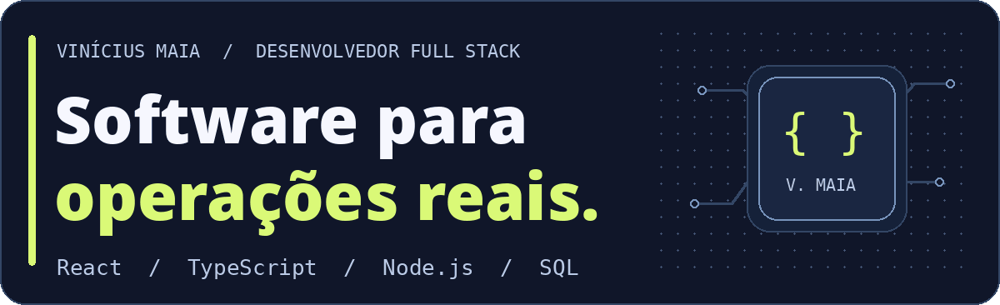
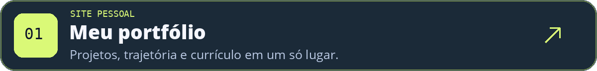

# Vinicius Maia

**Desenvolvedor Full Stack | React, TypeScript, Node.js e SQL**

Desenvolvo aplicações web e APIs para sistemas de gestão. Gosto de transformar regras de operação em fluxos que a equipe consegue usar e que eu consigo testar.

[Portfólio](https://vinicius-cyber-debug.github.io/) · [LinkedIn](https://www.linkedin.com/in/viniciusmaia001/)

## Por onde começar

## Projetos em destaque

### 1. Next Portaria · Controle de acesso

Modelei o fluxo de uma visita, da autorização à saída, com permissões por perfil e histórico de auditoria. Separei as regras de negócio da interface e da API para testar situações como uma chegada fora do horário autorizado.

**Versão atual (0.7):** React, TypeScript, Node.js e PostgreSQL 17. A arquitetura anterior usava Cloudflare Workers e D1/SQLite. A demo pública usa dados fictícios e não salva as alterações.

[Experimentar demo](https://vinicius-cyber-debug.github.io/Next-Portaria/) · [Ver código](https://github.com/vinicius-cyber-debug/Next-Portaria) · [Estudo de caso](https://github.com/vinicius-cyber-debug/Next-Portaria/blob/main/docs/ESTUDO-DE-CASO.md) · [Testes no GitHub Actions](https://github.com/vinicius-cyber-debug/Next-Portaria/actions/workflows/quality.yml)

### 2. Estoque API · Movimentações sem duplicidade

API REST em Node.js e SQLite. Saldo e histórico são gravados na mesma transação. Se uma movimentação já concluída for reenviada com a mesma chave e os mesmos dados, a API retorna o resultado anterior sem alterar o saldo novamente.

[Ver código e executar](https://github.com/vinicius-cyber-debug/estoque-api) · [Contrato OpenAPI](https://github.com/vinicius-cyber-debug/estoque-api/blob/main/openapi.json) · [Testes de integração](https://github.com/vinicius-cyber-debug/estoque-api/blob/main/test/api.test.mjs)

### 3. Griff Casual · Vitrine e estoque de uma loja

Vitrine em React com painel administrativo, Supabase e PostgreSQL. O painel demonstra o fluxo de cadastro de produtos, controle de estoque e acompanhamento de pedidos. O modo demo usa dados fictícios e não altera o banco real.

[Explorar painel demo](https://vinicius-cyber-debug.github.io/griff-casual-demo/?demo=1#/admin) · [Ver código](https://github.com/vinicius-cyber-debug/griff-casual-demo)
